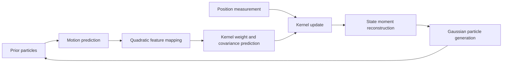

# Implementation and reproducibility

[Back to the overview](../README.md)

These notes describe the supplied source files and notebook. They are a guide to the current implementation, rather than a specification for every AKKF variant in the literature.

## Data flow



1. `AdaptiveKernelKalmanPredictor` propagates the prior particle states with the supplied transition model and constructs kernel features.
2. The predictor initializes or propagates kernel weights and covariance, using the regularization parameter spelled `lamda` in the API.
3. `AdaptiveKernelKalmanUpdater` incorporates the measurement through separate calculations for the x and y position components.
4. The updater reconstructs a four-component state estimate and generates a new set of Gaussian particles through `Generator`.
5. The notebook uses those particles as the prior for the next measurement.

## Main components

| Component | Defined in | Role |
| --- | --- | --- |
| `AdaptiveKernelKalmanPredictor` | [`predictor/kalman.py`](../predictor/kalman.py) | Predicts particle states, kernel weights, and kernel covariance |
| `AdaptiveKernelKalmanUpdater` | [`updater/kalman.py`](../updater/kalman.py) | Updates the kernel representation and reconstructs state moments |
| `quadratic_kernel` | [`kernel.py`](../kernel.py) | Computes the implementation's quadratic measurement-kernel values |
| `quadratic_feature_mapping` | [`kernel.py`](../kernel.py) | Builds the explicit feature arrays used by the predictor and updater |
| `Generator` | [`Generator.py`](../Generator.py) | Draws samples using `scipy.stats.multivariate_normal.rvs` |

The custom predictor and updater return tuples consumed by `sample.ipynb`. Their calling convention differs from the standard Stone Soup predictor/updater interface; use the notebook as the reference for connecting these components.

### Feature mapping

The current feature mapping reverses the state-coordinate order and stacks squared components, consecutive-coordinate cross terms, scaled linear terms, and a constant term. Cross terms are included when the computed cross-term array contains a nonzero value. These are implementation-specific details; do not assume this function enumerates every pairwise term of a general polynomial feature map.

### State and measurement assumptions

The example and custom updater use a four-dimensional state in the order `[x, vx, y, vy]`. The updater reads position from state rows 0 and 2 and uses a two-component position measurement. The current updater also reshapes the reconstructed state to four components; other state dimensions require implementation work.

## What the notebook produces

`sample.ipynb` contains one code cell. It:

- seeds NumPy with `1600`;
- creates an initial state and 20 one-second transitions, giving 21 ground-truth states and measurements;
- uses `500` particles and runs a prediction/update cycle for each measurement;
- stores updated state means in `E_buff`, covariance-related outputs in `Covar_buff`, gains in `Q_buff`, and kernel weights in `weight`;
- stores **predictions** in `track`;
- plots the mean predicted particle positions for indices 0 through 19 against the corresponding ground-truth positions.

The plotted curve is therefore different from a curve constructed from the updated state means in `E_buff`, and it omits the final index of the 21-state simulation. The existing updater also prints its reconstructed state and shape during execution.

No RMSE calculation or EKF benchmark is included in the example notebook.

## Reproducibility

Record the following with each experiment:

| Category | Record |
| --- | --- |
| Source | Repository commit and any local modifications |
| Environment | Python, Stone Soup, NumPy, SciPy, Matplotlib, and notebook-kernel versions |
| Motion | Transition model, time interval, initial state, and process-noise settings |
| Observation | Measurement model, state mapping, and measurement covariance |
| Filtering | Particle count, kernel parameters, and regularization values |
| Randomness | Random seed and how repeated trials vary it |
| Evaluation | Metric definition, state coordinates, time indices, and whether predictions or updates are evaluated |

Useful environment records can be collected with:

```bash
git rev-parse HEAD
python --version
python -m pip show stonesoup numpy scipy matplotlib
python -m pip freeze
```

The fixed seed makes the notebook's random choices explicit, but exact output also depends on the software environment. Start time is set with `datetime.now()`; comparisons should align relative time indices.

The repository currently contains no dependency lockfile, automated test suite, or complete experiment runner for all manuscript scenarios. A successful notebook run should be described as an example run, rather than as reproduction of the full research evaluation.

## Interpreting the research

The manuscript reports a wider set of tracking experiments and comparisons than the notebook exposes. Match the scenario definitions, filter configurations, metric definitions, and simulation conditions before comparing a new result with a manuscript table or figure. See [Research context](research.md).
